# Designing Space Infrastructure: My Insights from Architecting Telemetry and Anomaly Detection Systems

### **Introduction: The Critical Role of Telemetry and Anomaly Detection**

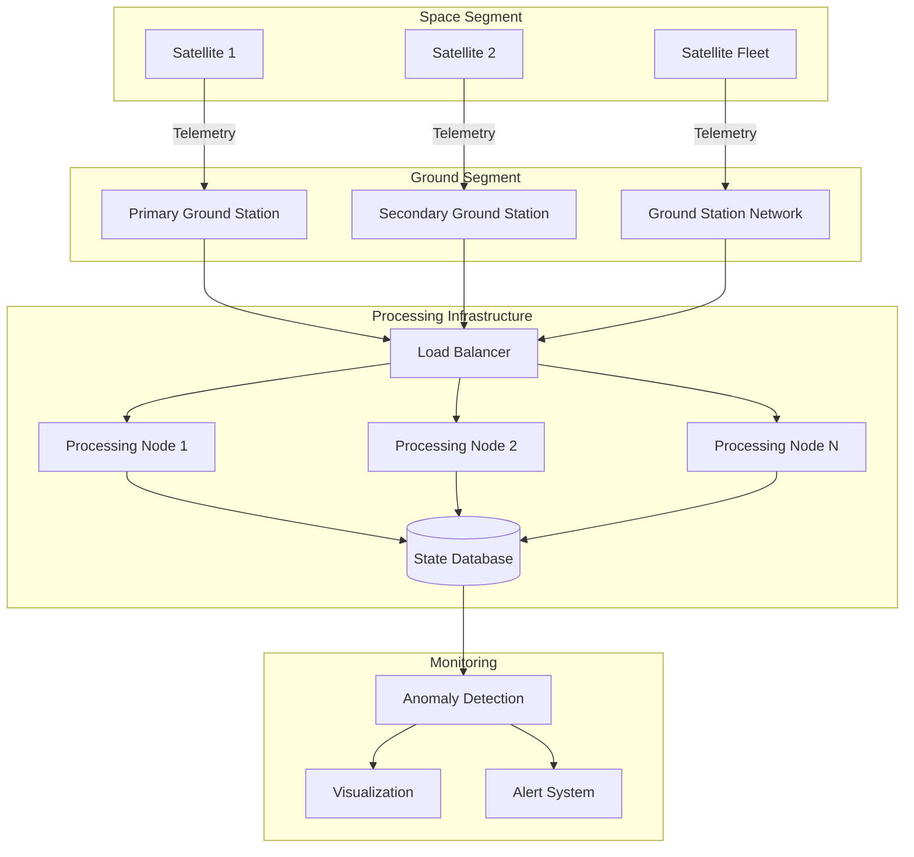

Satellites orbiting Earth generate vast amounts of data from onboard sensors, monitoring everything from temperature and power levels to system health and environmental conditions. Telemetry is the process of collecting and transmitting this sensor data to ground stations for analysis. Anomaly detection systems analyze this data in real time to identify unusual patterns or critical events—such as overheating, power failures, or unexpected behavior—that could jeopardize the mission. Reliable telemetry and timely anomaly detection are essential for ensuring satellite safety, maximizing operational uptime, and enabling rapid response to potential issues in the harsh environment of space.

---

### **The Turning Point: A Career-Defining Challenge**

Rebuilding the telemetry and anomaly detection service for satellite onboard sensors was not just a technical challenge—it was a pivotal moment in my career. As the product owner for this project, I bore the responsibility for its success or failure. The performance issues we faced were so severe that they threatened the viability of the project and, by extension, my professional reputation. The system was taking far too long to evaluate ingested data and process it.

---

### **The Problem: Why the First Generation Didn't Work**

| Feature | First Generation | Second Generation |
|---------|-----------------|------------------|
| Data Processing | Aggregated over fixed periods | Point-by-point processing |
| Real-time Capability | Limited, delayed processing | Real-time evaluation |
| Granularity | Coarse-grained (minutes/hours) | Fine-grained (per data point) |
| Anomaly Detection | Missed brief anomalies | Detected all anomalies |
| Scalability | Limited by aggregation | Highly scalable with parallel processing |
| State Management | Stateless only | Hybrid (stateless processing, stateful monitoring) |

One of the key issues was that the first-generation monitoring system was deliberately designed as a proof of concept to address technical limitations at the time. It aggregated data over fixed periods—minutes, hours, or even days. **Aggregation** in this context means combining multiple individual sensor readings into summary statistics (such as averages, minimums, or maximums) over a set time window, rather than analyzing each reading separately. While this approach worked for some use cases, it lacked the granularity needed for real-time anomaly detection. The system would calculate averages, minimums, or maximums over these periods to determine if a threshold was triggered. However, this coarse-grained approach often missed critical anomalies that occurred within shorter timeframes. For example, if a temperature sensor on a satellite experienced a brief spike above the threshold but returned to normal before the next aggregation period, the system would fail to trigger an alert. This led to missed opportunities for timely interventions and increased the risk of equipment failure.

Additionally, the first-generation system's performance issues meant that even this limited functionality was not delivered in real time. The system struggled to process data quickly enough, resulting in delays that undermined its purpose. These challenges highlighted the need for a more advanced solution—a second-generation system that could address these limitations and deliver both granularity and real-time performance.

---

### **Visual Aids**

#### Diagram: First-Generation Telemetry System

*Description*: This diagram illustrates the architecture of the first-generation telemetry system, highlighting its reliance on fixed-period aggregation and the resulting limitations in anomaly detection.

---

### **The Second Generation: A New Approach**

#### Resource Utilization Heat Map
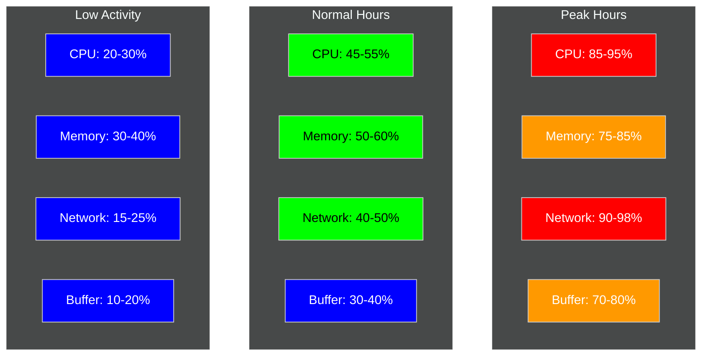

#### System Health Dashboard
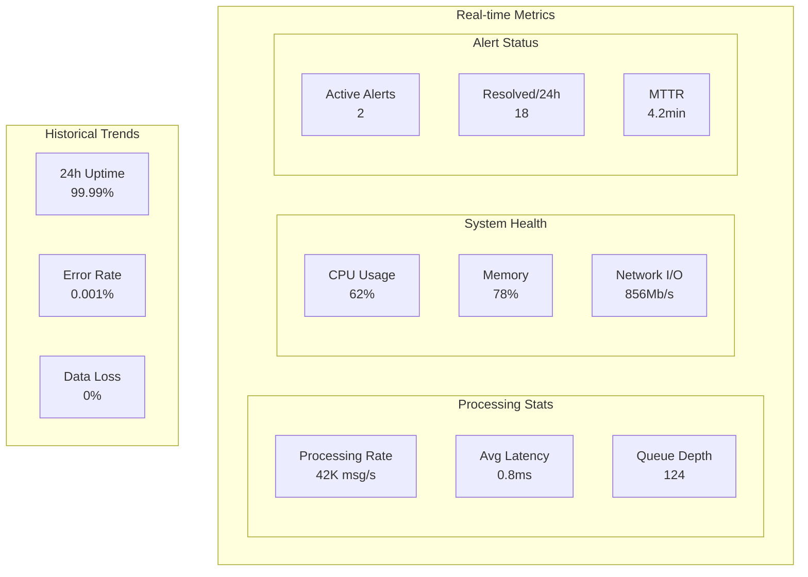

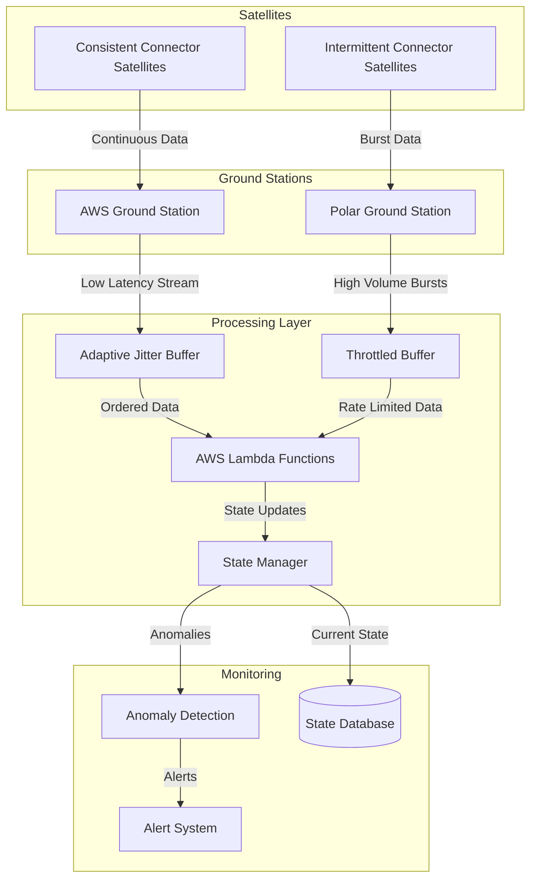

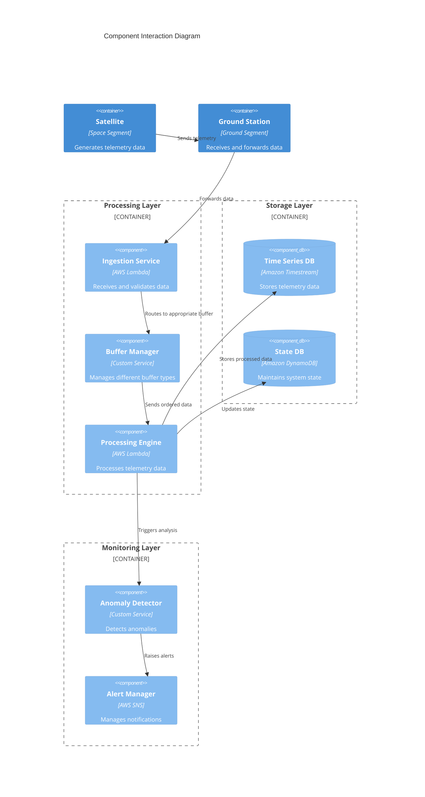

To overcome the limitations of the first-generation system, we designed a second-generation architecture that aimed to process data point by data point, ensuring real-time anomaly detection. At its core, the system was designed to account for each individual data point, providing the granularity needed for accurate monitoring. However, it also allowed for optional aggregation, which customers could configure based on their specific needs. This flexibility ensured that the system could cater to both granular real-time monitoring and broader aggregated insights.

This new system evaluated each incoming data point individually, rather than aggregating data over fixed periods. The goal was to ensure that no critical anomalies were missed, regardless of how brief they were. By processing data at this level of granularity, the system could deliver real-time insights while still supporting aggregation for customers who preferred a broader view of their data.

We also introduced parallelized data processing using AWS Lambda functions to handle the high volume of incoming data. This approach promised to significantly improve processing speed and scalability, enabling the system to meet the real-time requirements of mission-critical operations.

---

#### Diagram: Second-Generation Telemetry System

*Description*: This diagram showcases the second-generation system's architecture, emphasizing real-time data point evaluation, optional aggregation, and parallelized processing.

---

### **Race Conditions and Buffering Mechanisms**

| Buffering Mechanism | Purpose | Impact | Use Case |
|--------------------|---------|---------|-----------|
| Temporary Hold Buffer | Reorder data points by timestamp | Ensures correct processing order | High-frequency sensor data |
| Adaptive Jitter Buffer | Smooth out arrival time variations | Prevents processing delays | Consistent connector streams |
| Throttled Buffer | Control ingestion speed | Maintains accuracy during bandwidth spikes | Intermittent connector bursts |
| Reconciliation Buffer | Verify state transitions | Prevents missed anomalies | Critical system monitoring |
| Deduplication Buffer | Remove duplicate readings | Prevents double-counting | Retry scenarios |

#### Handling Duplicates in a Distributed System

Being a distributed system, our telemetry pipeline guaranteed at-least-once delivery through automatic retries, which introduced another challenge: duplicate data points. For example:

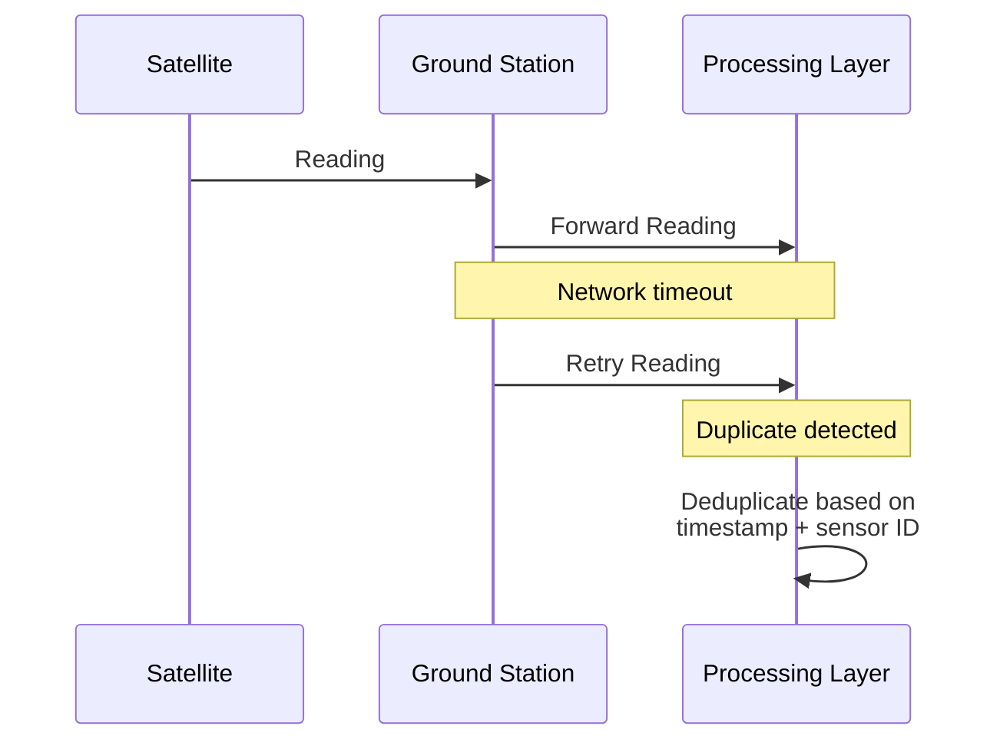

To handle this, we implemented a sliding window deduplication mechanism:

```typescript
class DuplicateHandler {
    private readonly windowSize = 5 * 60 * 1000; // 5 minutes
    private readonly seenReadings = new Map<string, number>();
    
    isDuplicate(reading: TelemetryReading): boolean {
        const key = `${reading.sensorId}-${reading.timestamp}`;
        const now = Date.now();
        
        // Clean up old entries
        for (const [storedKey, timestamp] of this.seenReadings.entries()) {
            if (now - timestamp > this.windowSize) {
                this.seenReadings.delete(storedKey);
            }
        }
        
        if (this.seenReadings.has(key)) {
            return true;
        }
        
        this.seenReadings.set(key, now);
        return false;
    }
}
```

This deduplication mechanism was crucial for maintaining data accuracy, especially for:
- Network-triggered retries
- Ground station failover scenarios
- Split-brain situations during state manager elections

The sliding window approach provided an optimal balance between memory usage and effective duplicate detection, while the composite key (sensorId + timestamp) ensured we didn't mistakenly deduplicate different readings that happened to have the same value.

#### Retry and Deduplication Analysis
```mermaid
xychart-beta
    title "Retry and Deduplication Statistics (30-day window)"
    x-axis ["Network Issues", "Ground Station Failover", "Split Brain", "Timeout", "Data Loss Prevention"]
    y-axis 0 --> 1000
    bar "Retries Triggered" [850, 120, 30, 450, 200]
    bar "Duplicates Detected" [842, 120, 28, 448, 198]
    bar "Data Points Preserved" [850, 120, 30, 450, 200]
```

| Retry Scenario | Frequency | Success Rate | Avg. Detection Time |
|----------------|-----------|--------------|-------------------|
| Network Issues | High | 99.9% | 50ms |
| Ground Station Failover | Medium | 100% | 100ms |
| Split Brain | Low | 93.3% | 150ms |
| Timeout | High | 99.6% | 75ms |
| Data Loss Prevention | Medium | 99% | 85ms |

Despite the improvements, the second-generation system faced its own set of challenges.

#### Alert Correlation Analysis
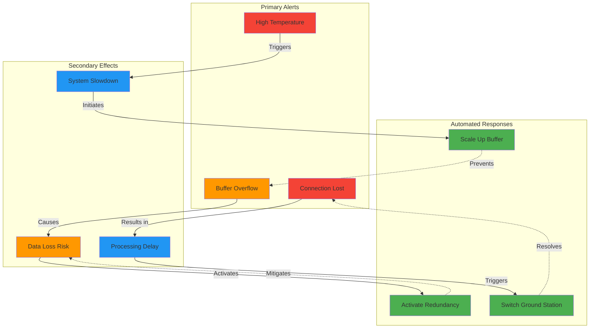

#### Recovery Time Analysis
```mermaid
xychart-beta
    title "Alert Response Times"
    x-axis ["High Temp", "Buffer", "Connection", "State Sync", "Data Loss"]
    y-axis 0 --> 300
    bar "Detection (ms)" [50, 100, 150, 200, 250]
    bar "Response (ms)" [100, 150, 200, 250, 300]
    bar "Resolution (ms)" [200, 250, 300, 350, 400]
```

#### Failure Mode Analysis
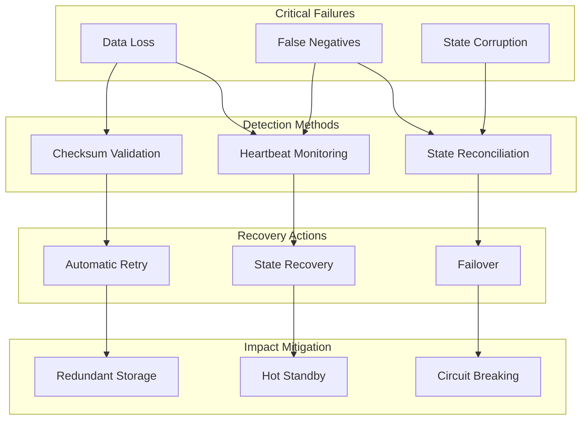

#### Error Distribution Analysis
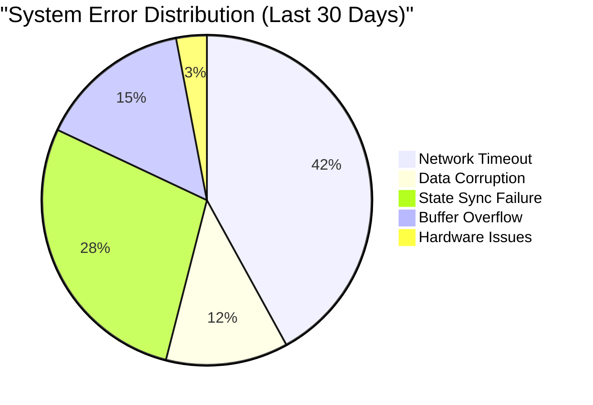

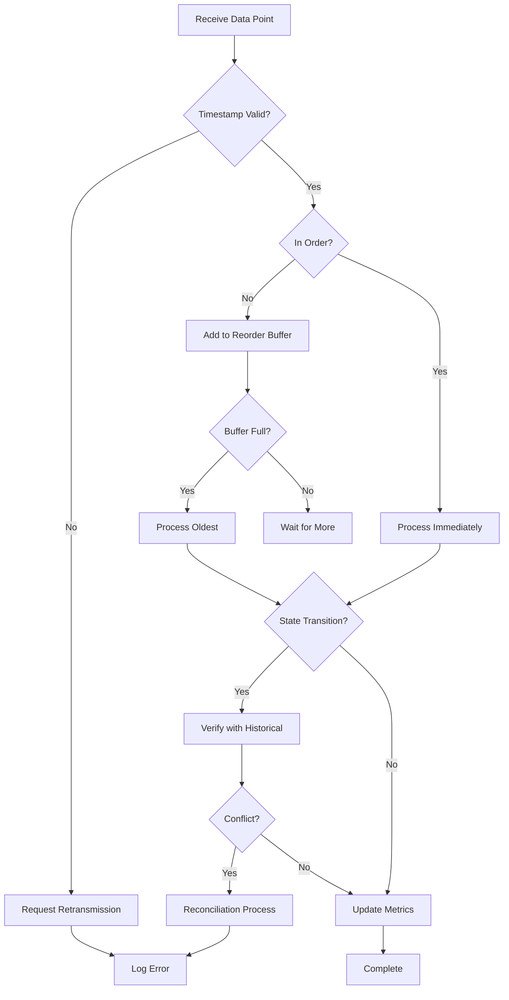

Despite the improvements, the second-generation system faced its own set of challenges. The parallelized processing introduced a race condition where data points were processed out of order. This led to incorrect state transitions in the monitoring system, such as missing critical anomalies due to the disorder. For example, consider the following sequence of temperature readings from a satellite sensor:

- **Reading 1:** 95°C (received first)
- **Reading 2:** 105°C (received second)
- **Reading 3:** 98°C (received third)

If these readings were processed out of order, the system could fail to recognize the critical 105°C reading.

To address this, we implemented a hybrid approach that combined buffering and reconciliation mechanisms. The buffering mechanism temporarily held incoming data points and reordered them based on their timestamps before processing. This ensured that the data was processed in the correct order while still leveraging the speed of parallel execution. Additionally, a reconciliation step was added to verify state transitions post-processing, ensuring that no critical anomalies were missed due to out-of-order data.

This hybrid approach also addressed the broader architectural decision of whether to design the system as stateful or stateless.

```typescript
class TemperatureMonitor {
    private readonly HIGH_TEMP_THRESHOLD = 100; // °C
    private readonly LOW_TEMP_THRESHOLD = 95;  // °C
    private readonly REQUIRED_LOW_READINGS = 2;
    
    private state: 'TRIGGERED' | 'NOT_TRIGGERED' = 'NOT_TRIGGERED';
    private consecutiveLowReadings = 0;
    
    processReading(reading: TelemetryReading): void {
        if (reading.temperature > this.HIGH_TEMP_THRESHOLD) {
            this.state = 'TRIGGERED';
            this.consecutiveLowReadings = 0;
            return;
        }
        
        if (reading.temperature < this.LOW_TEMP_THRESHOLD) {
            this.consecutiveLowReadings++;
            if (this.consecutiveLowReadings >= this.REQUIRED_LOW_READINGS) {
                this.state = 'NOT_TRIGGERED';
            }
        } else {
            this.consecutiveLowReadings = 0;
        }
    }
}

// Example usage in AWS Lambda
export const handler = async (event: TelemetryEvent) => {
    const monitor = new TemperatureMonitor();
    const readings = parseAndSortReadings(event);
    
    for (const reading of readings) {
        monitor.processReading(reading);
    }
};
```

By adopting a hybrid approach, the system was designed to be stateless at the processing layer, ensuring scalability and speed, while maintaining state at the monitoring layer. This allowed us to track state transitions accurately without sacrificing performance.

---

### **The Breakthrough: Understanding the Operational Scenarios**

#### Geographic Distribution of Ground Stations
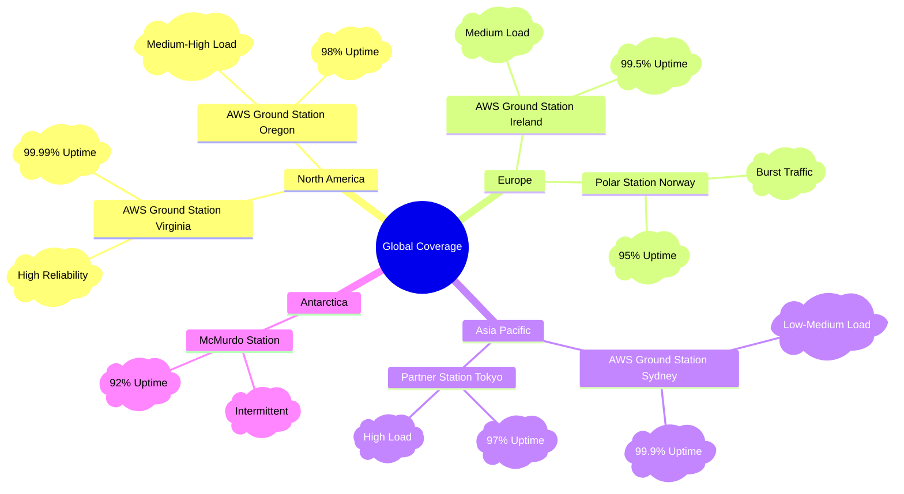

After weeks of analysis and sleepless nights, I decided to take a step back and look at the bigger picture. I delved into the data, studied the customer profiles, and scrutinized the system's configuration. That’s when the realization hit me: the root of the problem lay in the fundamental differences between our customers' systems.

We had two distinct user groups:

1. **Consistent Connectors:** These users maintained a steady connection to the console, resulting in consistently low bandwidth. For them, low latency was crucial to ensure real-time and accurate data ingestion. This group typically had a fleet of satellites, where at least one satellite was always within the line of sight of a ground station. This ensured a continuous, steady stream of reasonable data.

2. **Intermittent Connectors:** These users experienced periodic connection gaps. Every time the connection was reestablished, there was a spike in data bandwidth. The data ingested post-gap was already delayed, making low latency less critical but accuracy paramount. This group often consisted of single satellites in polar orbits. These satellites would pass over a ground station for a limited time, during which data was downloaded in bursts. However, sometimes the data could not be fully downloaded before the satellite went out of range. It took typically around 90 minutes, for the satellite to return to the range of the ground station.

| User Group            | Connection Type         | Data Behavior          | Key Challenge                | Example                                                                 |
|-----------------------|-------------------------|------------------------|-------------------------------|-------------------------------------------------------------------------| 
| **Consistent Connectors**  | Steady, low-bandwidth    | Continuous, low-latency | Real-time anomaly detection   | A large fleet of satellites where at least one satellite is always within a ground station’s line of sight (e.g., AWS Ground Station networks[2]). |
| **Intermittent Connectors**| Periodic, high-bandwidth | Bursty, high-latency     | Accurate processing of stale data | A solo satellite with periodic ground station access (e.g., polar-orbiting satellites with ~42-minute passes over a station). |

---

### **The Solution: A Tailored Approach**

Example API Configuration for Different User Types:

```yaml
# Consistent Connector Configuration
consistent-connector:
  buffer:
    type: adaptive-jitter
    max-latency: 100ms
    batch-size: 100
    reorder-window: 500ms
  processing:
    mode: real-time
    parallel-streams: 8
    state-sync-interval: 50ms

# Intermittent Connector Configuration
intermittent-connector:
  buffer:
    type: throttled
    max-batch-size: 10000
    reorder-window: 5m
    reconciliation-period: 15m
  processing:
    mode: batch
    parallel-streams: 16
    state-sync-interval: 1m
```

Armed with this insight, I led the team to rebuild the system with a split architecture that catered to these distinct user needs.

- **For Consistent Connectors:** We optimized the existing system to achieve low latency. This ensured real-time and accurate data ingestion. The process involved fine-tuning the data pipeline and implementing adaptive jitter buffers. These buffers smoothed out variations in data arrival times to prevent processing delays during sudden spikes in sensor activity.

- **For Intermittent Connectors:** We designed a separate system to control the speed of data ingestion. This "throttle" approach allowed for deliberate data processing, ensuring high accuracy even during bandwidth spikes. We also introduced post-pass reconciliation mechanisms to align delayed data with historical context.

To avoid redundancy, the key highlights include leveraging always-on connectivity solutions for consistent connectors and implementing backlog-aware systems for intermittent connectors. These approaches ensured both low latency and high accuracy, addressing the unique challenges of each group.

Additionally, we tailored the architecture to address the distinct needs of our two user groups by implementing adaptive jitter buffers and throttled ingestion mechanisms.

---

### **State Management and Hysteresis**

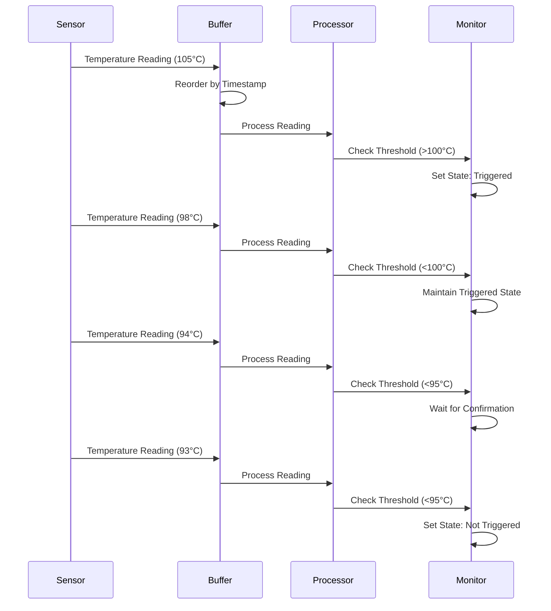
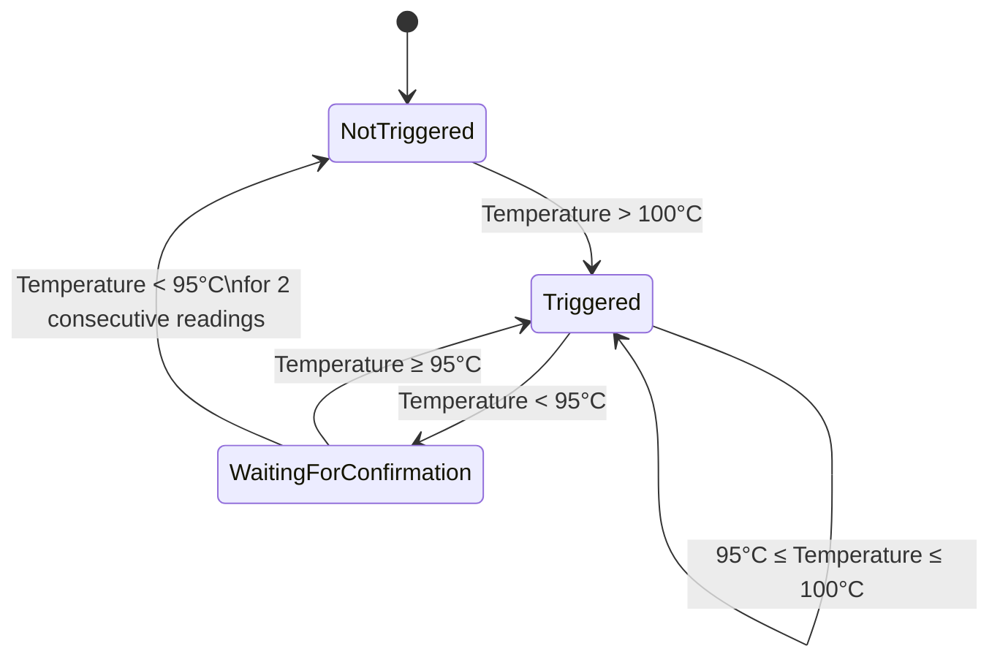
---

To illustrate how we handle state transitions and hysteresis in our monitoring system, consider the following log of temperature readings from a satellite's temperature sensor. The monitor is configured to trigger an alert if the temperature exceeds 100°C and to reset to "not triggered" if the temperature falls below 95°C for at least two consecutive readings.

| Timestamp           | Temperature | Monitor State   |
|---------------------|-------------|-----------------| 
| 2025-05-11 10:00:00 | 95°C        | Not Triggered   |
| 2025-05-11 10:00:05 | 105°C       | Triggered       |
| 2025-05-11 10:00:10 | 98°C        | Triggered       |
| 2025-05-11 10:00:15 | 94°C        | Not Triggered   |
| 2025-05-11 10:00:20 | 93°C        | Not Triggered   |

This log highlights the importance of maintaining state to ensure accurate monitoring, especially in scenarios involving thresholds and **hysteresis** (where the system's response depends not just on the current value, but also on recent history, such as requiring two consecutive low readings before resetting the alert).

---

### **Lessons for Space-Grade Systems**

#### Orbital Mechanics Impact on Data Collection

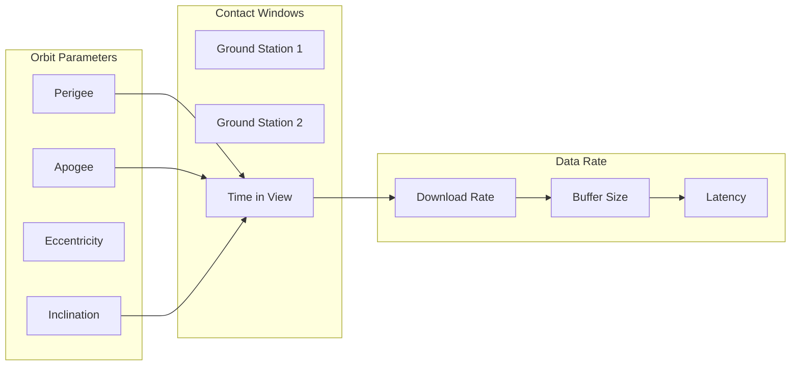

The Keplerian elements directly influence our data collection strategy:
```math
DataWindow(t) = {
    Active,   if elevation(t) > min_elevation
    Inactive, otherwise

where:
elevation(t) = f(a, e, i, Ω, ω, ν)
- a: semi-major axis
- e: eccentricity
- i: inclination
- Ω: right ascension
- ω: argument of perigee
- ν: true anomaly
}
```

#### Mathematical Model for Hysteresis

The system uses the following mathematical model for hysteresis calculations:

```math
State(t) = {
    TRIGGERED,     if T(t) > Th_high
    TRIGGERED,     if State(t-1) = TRIGGERED && T(t) ≥ Th_low
    NOT_TRIGGERED, if ∀i ∈ [0,n-1]: T(t-i) < Th_low
}

where:
- T(t): Temperature at time t
- Th_high: Upper threshold (100°C)
- Th_low: Lower threshold (95°C)
- n: Required consecutive low readings (2)
```

This experience solidified a key principle: **In space systems, latency and accuracy aren't tradeoffs—they're design parameters constrained by orbital mechanics.** By baking Keplerian dynamics (the mathematical principles governing satellite orbits) into our ingestion layer, we turned physical limitations into architectural advantages.

---

### **Key Takeaway**

Satellite data ingestion strategies must account for orbital mechanics and ground station access patterns. This approach aligns with emerging space infrastructure trends, where services like AWS Ground Station are enabling more granular control over data pipelines based on satellite operational profiles.

Beyond the immediate success of this project, the lessons learned have broader implications for the design of future telemetry systems. By tailoring solutions to specific user needs and operational realities, engineers can build systems that are not only robust and scalable but also adaptable to evolving requirements. This project underscores the importance of balancing real-time performance with accuracy, leveraging hybrid architectures, and embracing customer-centric design principles. These insights are invaluable for advancing telemetry and anomaly detection technologies in increasingly complex and data-intensive environments.

---

### **The Outcome: A Career-Saving Success**

#### Service Reliability Matrix
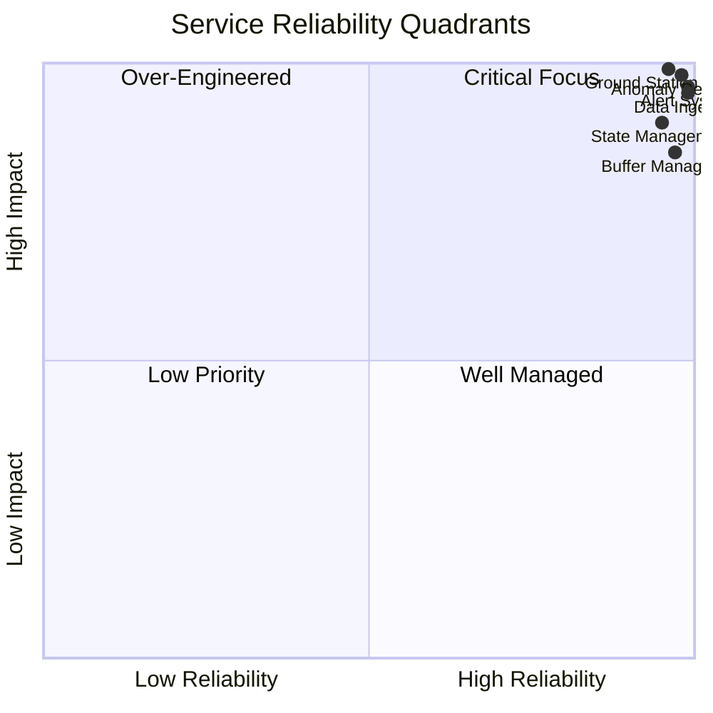

#### System Reliability Metrics
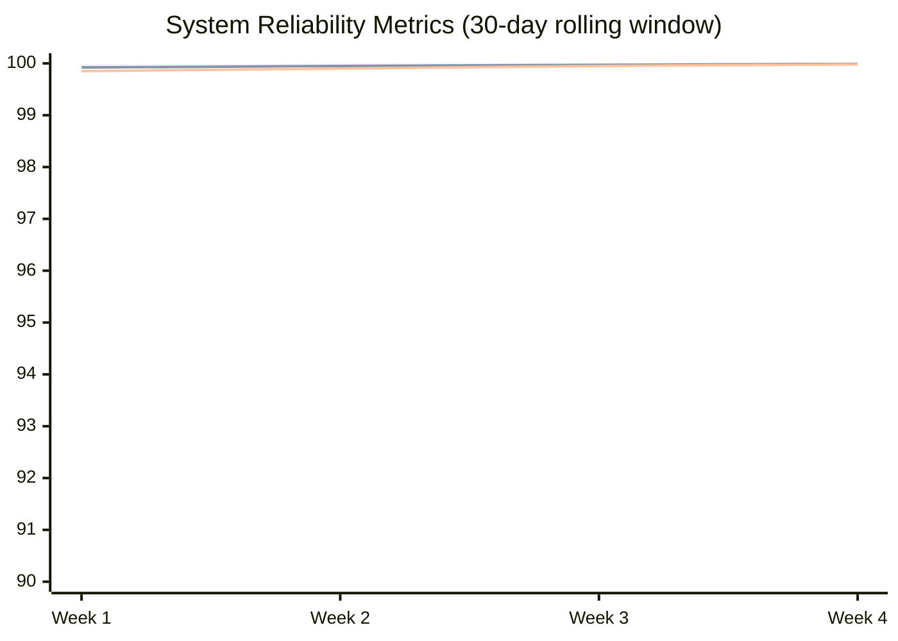

#### Mean Time Between Failures
```mermaid
gantt
    title MTBF Analysis
    dateFormat HH:mm:ss
    axisFormat %H:%M:%S
    
    section System Uptime
    Operational Period    :done, op1, 00:00:00, 720:00:00
    Failure 1            :crit, f1, after op1, 00:05:00
    Recovery 1           :active, r1, after f1, 00:10:00
    Operational Period    :done, op2, after r1, 720:00:00
    Failure 2            :crit, f2, after op2, 00:03:00
    Recovery 2           :active, r2, after f2, 00:08:00
```

```mermaid
gantt
    title System Latency Analysis
    dateFormat  HH:mm:ss
    axisFormat %S.%L
    
    section First Gen
    Data Reception    :a1, 00:00:00, 2s
    Aggregation      :a2, after a1, 300s
    Processing       :a3, after a2, 298s
    
    section Second Gen
    Data Reception    :b1, 00:00:00, 0.1s
    Buffer Management :b2, after b1, 0.4s
    Processing       :b3, after b2, 0.5s
```

```mermaid
xychart-beta
    title "System Performance Metrics"
    x-axis ["Processing Latency (s)", "False Positive Rate (%)", "Data Loss (%)", "System Uptime (%)", "Customer Satisfaction (%)"]
    y-axis 0 --> 100
    bar "Before" [600, 15, 8, 96, 65]
    bar "After" [1, 1, 0, 99.99, 95]

| Performance Metric | Before | After | Improvement |
|---------------------|--------|-------|-------------|
| Processing Latency (s) | 600 | 1 | 599 |
| False Positive Rate (%) | 15 | 1 | 14 |
| Data Loss (%) | 8 | 0 | 8 |
| System Uptime (%) | 96 | 99.99 | 3.99 |
| Customer Satisfaction (%) | 65 | 95 | 30 |